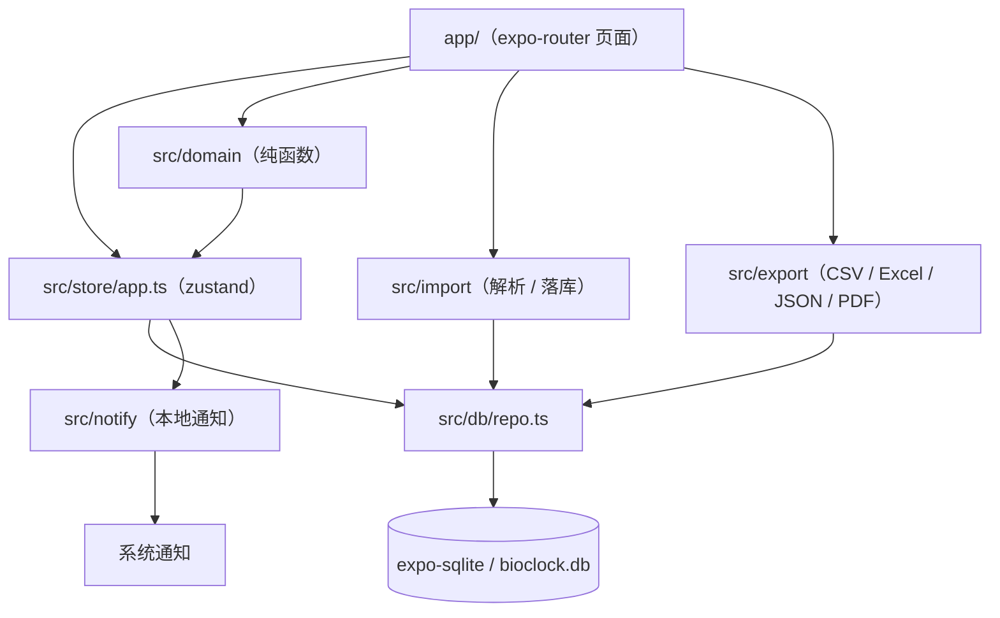
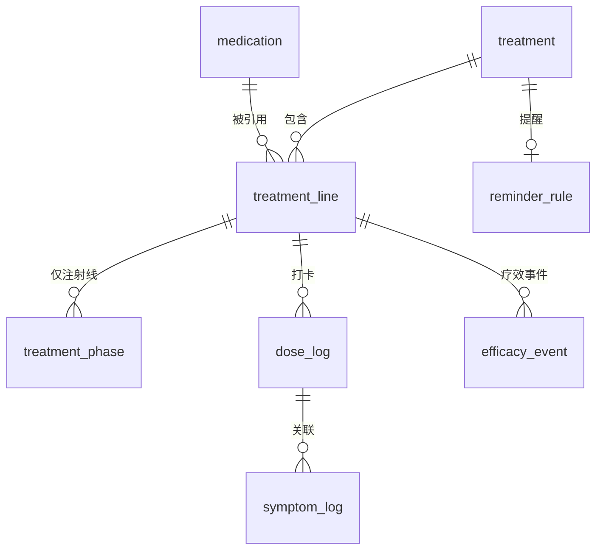
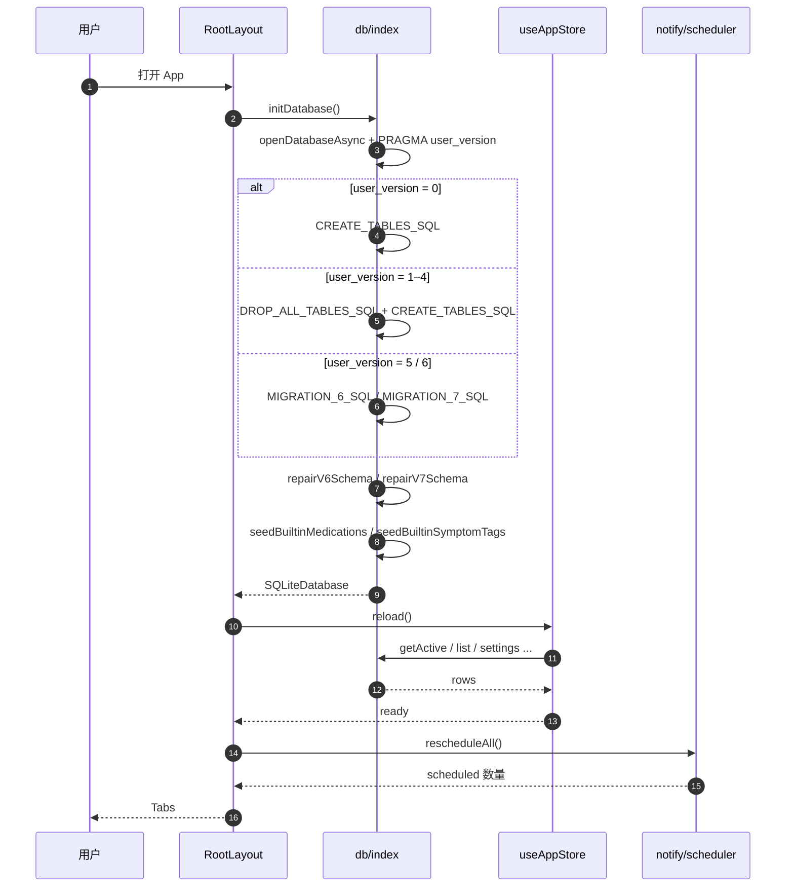
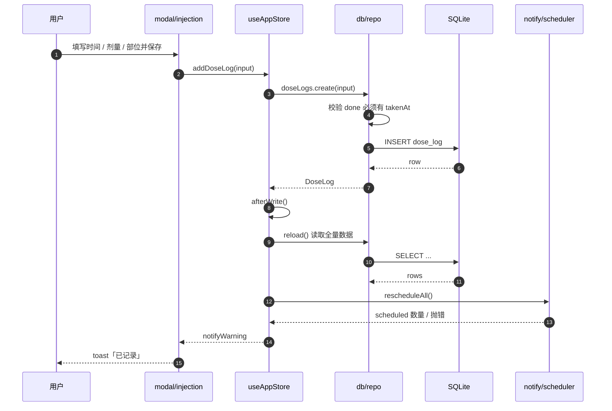
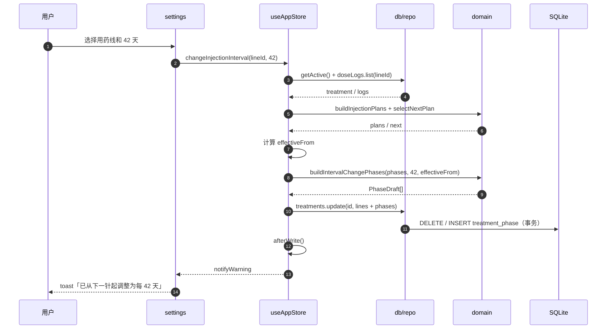
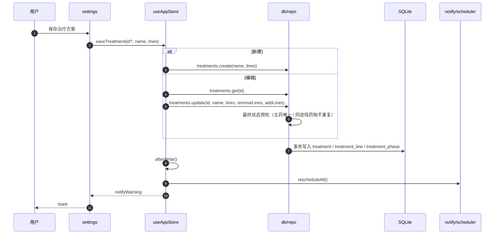
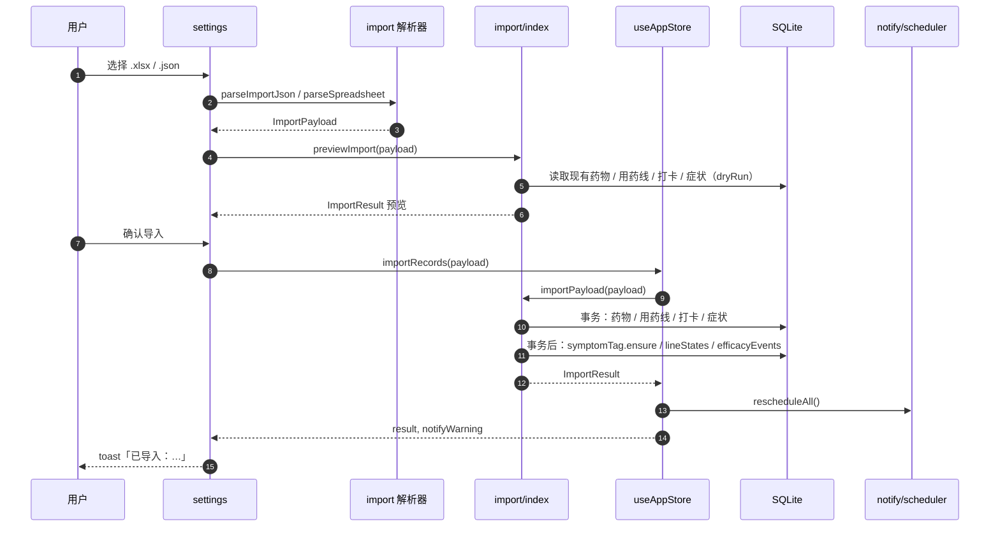
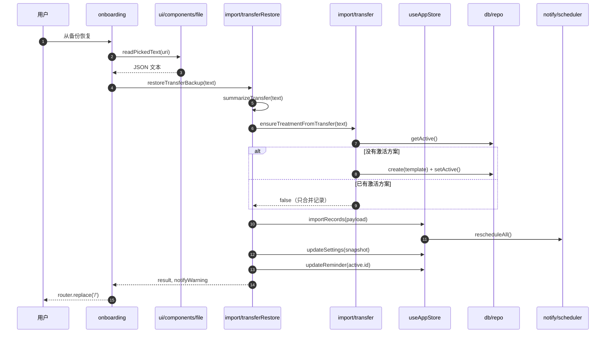
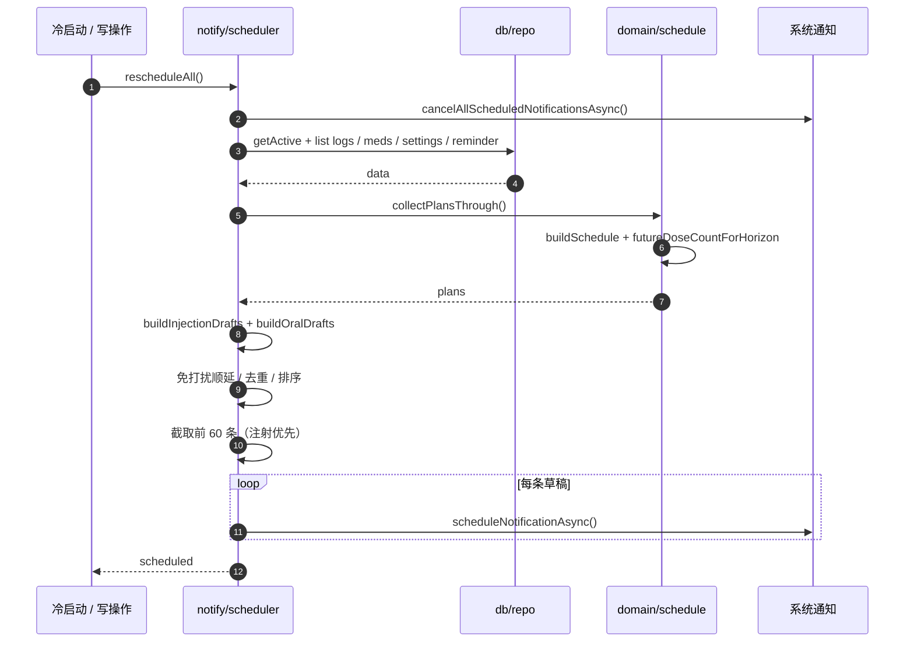
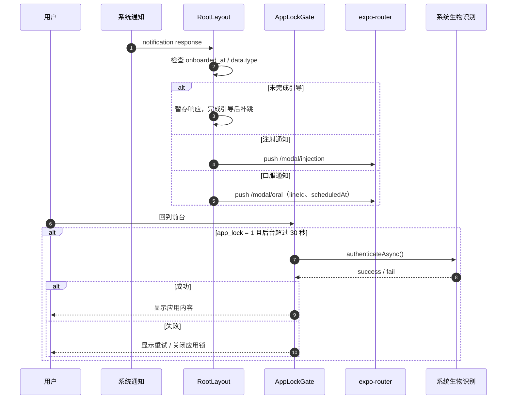

# BioClock 开发文档

| 项目 | 内容 |
| --- | --- |
| 当前版本 | 1.1.0 |
| 数据模型 | SQLite v7（`SCHEMA_VERSION = 7`） |
| 导入格式 | v3（兼容 v1 / v2） |
| 运行环境 | Expo SDK 58 / React Native 0.88 / React 19 / TypeScript strict |
| 文档更新 | 2026-11 |

> 本文档面向在本仓库工作的开发者与 AI 编码代理。
> 产品功能与用户流程见 [`product.md`](./product.md)；代理必须遵守的简短约定见仓库根目录 [`AGENTS.md`](../AGENTS.md)。

## 1. 快速开始

```bash
npm install
npm start                 # Expo 开发服务器
npm run android           # 连接真机 / 模拟器
npm run web               # 浏览器预览（expo-sqlite 能力受限）
npm run typecheck         # tsc --noEmit
npm test                  # vitest（纯函数 + 迁移测试）
npm run import-editor     # 生成 tools/import-editor/src/meta.{json,js}
npm run import-template   # 生成 Excel 导入模板
```

本机开发环境是 Windows + PowerShell 5.1。涉及建库 / 迁移的测试依赖 Node 22+ 的 `node:sqlite`。

提交前至少执行：

```bash
npm run typecheck
npm test
npx expo export --platform android --output-dir .expo-verify
```

> `npx expo export --platform web` 目前会因 `expo-sqlite` 的 wasm 资源报错，这是已知问题，用 Android 打包验证。

## 2. 技术栈

| 层次 | 选择 |
| --- | --- |
| 框架 | Expo SDK 58、React Native 0.88、React 19 |
| 路由 | expo-router（文件路由） |
| 语言 | TypeScript strict |
| 状态 | zustand（单一 store） |
| 数据库 | expo-sqlite（手写 SQL，无 ORM） |
| 通知 | expo-notifications（本地通知） |
| 文件 | expo-document-picker、expo-file-system、expo-sharing、expo-print |
| 安全 | expo-local-authentication（应用锁） |
| 表格 | SheetJS `xlsx`（导入解析与 Excel 导出） |
| 图形 | react-native-svg（症状时间线、人体部位图） |
| 测试 | vitest |
| 设备 | Expo Go（开发）/ EAS Build（发布） |

**硬性约束**：不新增网络请求、账号、云同步、第三方分析 SDK；数据库与导出文件不得提交到仓库。

## 3. 架构总览



### 分层职责

| 层 | 位置 | 职责 |
| --- | --- | --- |
| 路由 / UI | `app/` | 页面、弹窗、交互、导航 |
| 通用 UI | `src/ui/` | 主题 token、基础组件、日期格式化、图标 |
| 全局状态 | `src/store/app.ts` | 读取全量数据、统一写后刷新与通知重排 |
| 领域纯函数 | `src/domain/` | 排程、间隔、轮换、依从性、疼痛、药名匹配、日历 |
| 持久化 | `src/db/` | 建表、迁移、播种、仓库层 |
| 导入 | `src/import/` | JSON / Excel 解析、落库、换机恢复 |
| 导出 | `src/export/` | CSV / Excel / JSON / PDF / 换机快照 |
| 通知 | `src/notify/` | 生成并写入本地通知、通知文案 |
| 只读目录 | `src/data/` | 病种、药物目录与方案模板 |

### 依赖方向

- `src/domain` 不依赖 React Native、SQLite、Expo，只依赖 `src/types.ts` 和只读目录，便于 vitest 直接测试。
- `src/db/repo.ts` 只负责 SQL 与行 / 对象映射，不依赖 UI。
- `app/` 通过 store 或 repo 读写；写操作必须走 store 的统一写后流程（见第 8 节）。
- `src/import` / `src/export` 可以复用 repo；解析器（`schema.ts`、`spreadsheet.ts`）保持纯函数。

### 核心设计：下次时间不落库

`nextDoseAt` 之类的计划表**不写入数据库**。每次由「治疗线 + 阶段 + 打卡记录 + 当前时间」实时推导，避免「改了方案但计划表是旧的」这类不一致问题。

## 4. 目录结构

```text
app/
  (tabs)/                  今天 / 记录 / 日历 / 趋势 / 设置
  modal/                   注射登记、口服打卡、症状登记
  onboarding/              四步引导 + 换机恢复入口
  _layout.tsx              根布局、启动加载、通知点击、应用锁
src/
  data/                    病种、生物制剂目录、方案模板（只读）
  db/                      schema.ts / index.ts / seed.ts / repo.ts
  domain/                  schedule / interval / preview / rotation /
                           adherence / pain / medication / calendar
  import/                  schema / spreadsheet / index / transfer / transferRestore
  notify/                  scheduler / content
  export/                  csv / excel / json / pdf / transferFile / transferSchema
  store/app.ts             zustand 全局状态
  ui/                      主题、组件、日期、图标
  i18n/zh.ts               用户可见文案
tools/import-editor/       静态网页补录工具
docs/                      产品、开发、契约、导入格式、设计稿、模拟器备忘
```

路径别名：`@/*` → `src/*`，`@/assets/*` → `assets/*`。

## 5. 数据模型（v7）

### 5.1 关系



### 5.2 表一览

| 表 | 用途 |
| --- | --- |
| `medication` | 药物；`route` 为 `sc / iv / oral`；`brand_names`、`disease_ids`、`extra` 存 JSON 文本 |
| `treatment` | 治疗组合；同一时间只有一个 `is_active = 1` |
| `treatment_line` | 每条药一条；`kind` 为 `injection / oral` |
| `treatment_phase` | 仅注射线，按 `order_idx` 执行；`effective_from` 支持改间隔 |
| `efficacy_event` | 疗效下降 / 失效 / 不耐受 / 抗药抗体 / 其他 |
| `dose_log` | 注射与口服统一的打卡记录；`status` 为 `done / skipped / missed` |
| `symptom_log` | 症状；`dose_log_id` 关联打卡（对外字段仍叫 `injectionId`） |
| `symptom_tag` | 可维护的症状标签 |
| `reminder_rule` | 每个治疗方案一条提醒规则 |
| `app_setting` | 键值设置 |

### 5.3 关键列

- `treatment_line`：`is_host`（主药）、`sync_with_host`（跟随主药）、`anchor`（actual / planned）、`window_days`、`ended_at`、`oral_*` 列。
- `treatment_phase`：`kind`（loading / maintenance）、`interval_days`、`repeat_count`（0 = 无限）、`dose`、`unit`、`effective_from`。
- `dose_log`：`scheduled_at`、`taken_at`、`status`、`dose`、`unit`、`site`、`lot_number`、`note`。
- `symptom_log`：`logged_at`、`severity` 1–5、`pain_score` NRS 0–10、`tags` JSON 快照、`temperature`、`dose_log_id`。

`app_setting` 常用键：

| 键 | 用途 |
| --- | --- |
| `disease_ids` | 多病种 ID 的 JSON 数组（当前写入格式） |
| `disease_id` | 旧版单病种键，仅兼容读取 |
| `patient_name` | PDF 报告默认姓名 |
| `onboarded_at` | 是否完成首次引导 |
| `app_lock` | 应用锁开关（`'1'` / `'0'`） |
| `theme_mode` | `system / light / dark` |
| `dnd_start` / `dnd_end` | 免打扰起止时间 `HH:mm` |
| `symptom_tags_seeded` | 症状标签是否已播种的内部标记 |

### 5.4 不变量

1. 同一时间**至多**一个 `is_active = 1` 的 `treatment`；允许用户停用后暂时没有激活方案（`getActive()` 返回 `null`）。
2. 一个治疗方案最多一个 `is_host = 1` 的注射线；口服线不能当主药或同步线。
3. 同一治疗方案里，同一种药在同一 `kind` 下不能重复；同一种药可以分别作为注射线和口服线。
4. 注射线至少有一个 `treatment_phase`；口服线不保存阶段。
5. `effective_from` 只允许出现在维持阶段。
6. `dose_log.status = 'done'` 时必须提供 `taken_at`。
7. 时间统一存 UTC 毫秒；导入 / 导出文件使用本地时间字符串 `YYYY-MM-DD HH:mm`。
8. `symptom_log.dose_log_id` 删除打卡时置空，不级联删除症状。

> 这些不变量主要由仓库层维护；数据库层只对部分枚举（`kind`、`anchor`、`status`、`severity` 等）做了 `CHECK`，直接执行 SQL 可以绕过应用层校验。新代码应通过 repo 写入。

### 5.5 迁移策略

| `PRAGMA user_version` | 行为 |
| --- | --- |
| `0` | 只执行 `CREATE_TABLES_SQL` |
| `1–4` | `DROP_ALL_TABLES_SQL` → `CREATE_TABLES_SQL`（v5 重建的一次性例外） |
| `5` | `MIGRATION_6_SQL` + `MIGRATION_7_SQL` |
| `6` | `MIGRATION_7_SQL` |
| `> 7` | 拒绝打开，提示更新 App |

补充：

- `user_version = 0` 但存在 `regimen / regimen_phase / injection` 旧表时，按 v1 处理并重建。
- `repairV6Schema` / `repairV7Schema` 会按实际列补齐缺失结构，幂等且不删数据。
- v5 之后的结构变更只允许加列 / 加表，不再删除用户数据。
- `DELETE_ALL_BUSINESS_DATA_SQL` 删除业务表、保留内置药并重新播种症状标签；`DROP_ALL_TABLES_SQL` 同时列出新旧表名。

修改表结构时必须同步：`src/db/schema.ts`、`src/db/index.ts`、`src/db/repo.ts`、`src/types.ts`、`src/domain/__tests__/migration.test.ts`、`docs/contract.md`。

### 5.6 播种

- 内置药：`seedBuiltinMedications` 按 `catalog_key` 认领，兼容老库的 `generic_name`。
- 症状标签：`seedBuiltinSymptomTags` 用 `app_setting.symptom_tags_seeded` 标记，不使用「表为空就播种」，避免用户删空后被重新塞回。

## 6. 仓库层

入口：`src/db/repo.ts`。完整签名与输入类型见 [§17.2](#172-仓库层)。

| 模块 | 主要方法 |
| --- | --- |
| `medications` | `list` / `listForDisease` / `get` / `create` / `update` / `remove` |
| `treatments` | `list` / `getActive` / `get` / `create` / `addLine` / `removeLine` / `setLineEnded` / `setActive` / `update` / `remove` |
| `efficacyEvents` | `list` / `create`（可选 `stopLine`）/ `remove` |
| `doseLogs` | `list` / `listBetween` / `create` / `update` / `remove` |
| `symptoms` | `list` / `create` / `update` / `remove` |
| `symptomTags` | `list` / `create` / `remove` / `ensure` |
| `reminderRules` | `getFor` / `upsert` |
| `settings` | `all` / `get` / `set` |

约定：

- 行类型使用 snake_case，映射函数转成 camelCase。
- JSON 列解析失败时回退为空数组 / 空对象，不抛异常。
- 输入校验统一抛中文错误；时间戳必须大于 0，剂量不能为负，疼痛 0–10，体温 30–45℃。
- 写操作尽量放在事务里；`addLine` 不自己开事务，便于导入复用。
- `treatments.update` 会做「最终状态」预检：主药唯一、同途径药物不重复。
- `setActive` 维护「同一时间只有一个激活方案」。

## 7. 领域层

> 完整函数签名与 `SchedulePlan` 字段见 [§17.3](#173-领域层)。

### 7.1 排程计划

`SchedulePlan` 的字段：

| 字段 | 含义 |
| --- | --- |
| `index` | 第几针 / 第几次打卡，从 0 开始 |
| `lineId` / `treatmentId` / `medicationId` | 所属线、方案、药物 |
| `kind` | `injection / oral` |
| `phaseId` / `phaseKind` | 注射线才有 |
| `plannedAt` | 计划时间（UTC 毫秒） |
| `status` | `done / due / upcoming / overdue / missed` |
| `dose` / `unit` | 该阶段剂量 |
| `actualAt` / `deviationDays` | 实际执行时间与偏差天数 |
| `windowStatus` | `on_time / early / late` |
| `doseLogId` | 对应的打卡记录 |

状态判定：

- 有实际记录 → `done`；
- 无记录且计划时间早于「现在 - 1 天」→ `overdue`；
- 与现在相差不超过 1 天 → `due`；
- 其余 → `upcoming`；
- skipped 且计划日已过 → `missed`，未到 → `upcoming`。

窗口判定：`|实际 - 计划| <= windowDays * 1 天` 为 `on_time`，否则按早晚判 `early / late`。

### 7.2 注射线排程

`buildInjectionPlans`：

1. 第 0 针：首条打卡的时间（`scheduledAt`，没有则 `takenAt` / `createdAt`）；完全没有记录时用今天本地零点。
2. 后续每针：
   - `anchor = actual`：上一针实际时间 + 当前阶段间隔；
   - `anchor = planned`：上一针计划时间 + 当前阶段间隔。
3. 阶段选择：
   - 有 `effective_from` 的阶段按日期生效，取生效时间不晚于计划时间的最后一个；
   - 没有生效时间的阶段按 `repeat_count` 次数推进；
   - `repeat_count = 0` 表示无限维持。
4. 打卡匹配：优先 `scheduledAt === plannedAt`，其次在容差内找最近记录；容差为 `max(2, windowDays + 1, ceil(intervalDays / 2))` 天。
5. 停用线：`ended_at` 之后不再生成普通未来计划；如果确实有补录记录，仍按实际时间展示。
6. 未来计划默认只生成 2 针；日历页传更大的 `futureDoseCount`，通知排程用 `futureDoseCountForHorizon` 按窗口计算。
7. 防御上限：`MAX_PLANS = 100000`。

同步线 `syncWithHost`：直接跟随本治疗方案的主药针日，不自己累加；主药计划不足时用本线最后一个阶段的间隔继续延伸。

### 7.3 口服线排程

`buildOralPlans`：

- 起点：`oral.startDate` 当天的本地零点。
- `daily`：每天；`weekly`：每周 `timesPerPeriod` 次，按周一为起点均匀分布；`custom`：固定周几。
- 历史全量输出，未来默认覆盖 14 天（`ORAL_HORIZON_DAYS`）。
- `durationDays` 非空时疗程结束停止；`endedAt` 后停止。
- 未认领的打卡：在最后一个计划边界（疗程结束 / 停用时间的较早者）之后，按天追加为计划点，避免「库里有、界面没有」。
- 计划外的临时服药仍留在历史里，不当作漏服计划。

### 7.4 下一步选择

`selectNextPlan`：

1. 今天到期的计划；
2. 最近 30 天内最近一次逾期；
3. 最近的未来计划；
4. 都没有 → `null`（结束的方案不再一直提示旧漏针）。

`nextDose` / `nextDoseForLine` 是对 `buildSchedule` / `buildLineSchedule` 的封装。

### 7.5 间隔调整

`buildIntervalChangePhases`：

- 只允许在维持阶段调整；
- 在 `effectiveFrom` 追加一个新的维持阶段；
- 删除 `effectiveFrom` 及之后的所有旧生效阶段，避免连续缩短间隔时旧阶段再次生效；
- 旧阶段保留，补录生效时间之前的历史记录仍按旧间隔计算。

`store.changeInjectionInterval` 会根据当前计划和锚点算出 `effectiveFrom`，再调用仓库更新阶段。

### 7.6 方案预览

`buildPhasePreview`（`src/domain/preview.ts`）与正式排程使用同一套 `repeatCount` 语义：`repeatCount` 是该阶段的总针数，0 表示无限。引导页的「方案总览」必须用它，不能另写一套循环。

### 7.7 部位轮换

8 个皮下位点：腹部左上 / 右上 / 左下 / 右下、左 / 右大腿、左 / 右上臂。

`recommendSite` 规则：

1. 排除最近 2 次用过的位点；
2. 选历史使用次数最少的；
3. 同分时优先与最近一次不同侧；
4. 仍同分时腹部优先。

`SiteHistoryEntry` 只包含 `{ site, injectedAt }`，与具体记录模型解耦。

### 7.8 依从性

`computeAdherence` 按用药线统计：

- 注射线：已完成、按时 / 提前 / 延迟、平均偏差、漏打、未来计划、最近连续按时次数；
- 口服线：完成、漏服、未来计划、完成率；
- 逾期超过 7 天才计为漏用（`MISSED_AFTER_DAYS = 7`），窗口内仍可补登记；
- `upcoming` 受排程默认覆盖范围限制（注射约 2 针、口服 14 天），不是整个方案剩余针数。

### 7.9 疼痛

NRS 0–10：0 无痛、1–3 轻度、4–6 中度、7–10 重度。分档只用于展示与配色。

### 7.10 药名匹配

`normalizeMedicationName` 去掉空格、中英文括号、方括号、`·`、`-`、`_`、`/` 等分隔符并转小写。

别名集合 = 药名 + 通用名 + 商品名 + 目录中该药的名称。匹配时先精确药名，再按别名；多条命中时内置药优先。

### 7.11 日历

`src/domain/calendar.ts` 统一按本地自然日归组：

- `buildMonthCells` 生成 6×7 格，周一起始；
- `groupPlansByDay` 按本地零点分组并按计划时间升序。

### 7.12 通知覆盖计算

`futureDoseCountForHorizon(lines, horizonDays)` 取所有注射线阶段的最短间隔，计算覆盖窗口所需的未来针数（最少 2 针，最多 1000）。通知排程必须使用它，否则 14 / 7 天间隔的药只会排到约 4 周。

## 8. 全局状态与写链路

`src/store/app.ts` 持有。完整 `AppStore` 签名见 [§17.4](#174-store-api)。

- `treatment` / `treatments`
- `doseLogs`
- `efficacyEvents`
- `medications` / `symptoms` / `symptomTags`
- `reminder`
- `settings` / `diseases` / `disease`
- `ready` / `refreshing` / `error`

所有写操作统一顺序：

```text
repo 写入
  → useAppStore.reload()
  → rescheduleAll()
  → 返回 notifyWarning
```

- 通知排程失败**不回滚数据**，由调用方 toast 提示。
- `reload` 并行读取方案、设置、药物、症状、标签、打卡、疗效事件；当前激活方案存在时再读提醒规则。
- 所有 UI 写操作应走 store 的 action，不要直接调 repo（导入 / 恢复等特殊流程除外）。

## 9. 通知系统

`src/notify/scheduler.ts`。完整签名见 [§17.6](#176-通知)。

- 滚动预排 **56 天**；单次最多 **60 条**，先保证注射提醒，再用剩余额度排口服。
- 注射提醒：
  - 按 `reminder_rule.offsets` 生成（UI 可选 -3 / -2 / -1 / 0 天）；
  - 默认 `[-2, -1, 0]`，提醒时间默认 09:00；
  - 偏移包含 0 时，注射日当天 20:00 再加一条「今天还没登记」补提醒；
  - 文案区分皮下注射 / 医院输注，并提示冷藏药回温。
- 口服提醒：
  - 按每条线的 `oral.remindTime` 生成；
  - 同一天、同一提醒时间合并成一条；
  - 日期已过或提醒时间已过的不再补排；
  - **没有 `reminder_rule` 时仍会生成口服提醒**；只有 `reminder.enabled === false` 才会关闭口服推送。
- 免打扰（默认 22:00–08:00）：落入区间的提醒顺延到区间结束；跨日顺延会破坏「今天 / 明天」文案，因此直接丢弃该条。
- 点击通知：按 `data.type = 'dose'` 和 `kind` 跳转到注射 / 口服弹窗；引导期间点击会暂存，完成引导后补跳。
- 排程串行化：`rescheduleAll` 内部用 generation + 队列避免并发重排互相覆盖；每次重排先 `cancelAll`。
- `ensurePermissions` 返回通知权限和 Android 精确闹钟状态。

已知未实现：`snoozeMinutes` 已存储并在设置页可调，但尚未注册通知 category / action；App 回到前台也没有自动补排（只在冷启动和写操作后重排）。

## 10. 导入 / 导出 / 换机

### 10.1 导入 v3

入口：`src/import/index.ts`。完整 API 见 [§17.5](#175-导入--导出--换机)。

- 支持 `.xlsx` / `.xls` / `.json`；JSON 顶层：
  `{ format: 'bioclock-import', version: 3, medications, injections, oralLogs, symptoms, lineStates, efficacyEvents }`。
- v1 / v2 仍兼容；每个数组最多 2000 条。
- 时间必须是本地时间字符串 `YYYY-MM-DD HH:mm`（也接受 `T`、斜杠、秒）。
- 解析器 `src/import/schema.ts`、`src/import/spreadsheet.ts` 是纯函数，不碰 React Native。
- 落库流程：
  1. 合并 / 新建药物（按药名、通用名、商品名、目录名互认）。
  2. 解析每条记录到「同药的用药线」；找不到时自动建线。
  3. 药物 / 用药线 / 打卡 / 症状在一个事务里写入。
  4. 症状标签、用药线停用状态、疗效事件在事务提交后补齐。
- 去重：
  - 打卡按「最终落库时间 + 用药线」；
  - 症状按「记录时间 + 严重程度 + 排序后的标签组合」；
  - 同一文件内重复记录只保留第一条。
- `resolveImportLogTime` 统一时间语义：done 用实际时间，skipped / missed 用计划时间（没有计划时间才退回事件时间）。
- `previewImport` 用同一套逻辑只算数量，不写库。

### 10.2 导出

| 格式 | 内容 |
| --- | --- |
| CSV | 只导出注射线记录，10 列：注射时间、药名、通用名、剂量、单位、部位、批号、备注、计划时间、偏差天数；UTF-8 BOM |
| Excel | 5 张表：注射记录、症状记录、药物、口服打卡、用药线；注射表含状态列 |
| JSON | v3 格式，可直接再导入；时间用本地时间字符串 |
| PDF | 就诊报告：患者姓名（可选）、统计范围、注射记录、症状摘要、依从性统计；范围 90 / 180 / 365 天，默认 180 |
| 换机快照 | `bioclock-transfer` v1，包含方案、用药线、阶段、口服计划、提醒、设置、症状标签、打卡、疗效事件和 `schemaVersion` |

所有导出文件写入应用 cache 目录，再通过 `expo-sharing` 主动分享；导出前提示包含健康信息。

### 10.3 换机恢复

- 新设备：引导页第一步「从备份恢复」→ `restoreTransferBackup`。
- 流程：`summarizeTransfer` → `ensureTreatmentFromTransfer`（无激活方案时按快照建方案）→ `importRecords` → 恢复设置 / 提醒 → 进入首页。
- 已有激活方案时只合并记录，不重建方案结构。
- 快照校验：`format`、`version`、`schemaVersion`、必要数组；来自更新版本的备份会拒绝导入。
- `skipped / missed` 打卡、原始 `scheduledAt`、空部位和未被症状引用的症状标签都会保留。
- 恢复时不会继承 `app_lock`，避免新设备没有生物识别被锁在门外。

### 10.4 网页补录工具

`tools/import-editor/` 是纯静态网页工具：

- 无框架、无构建、无 CDN，双击 `index.html` 即可用；
- 病种 / 药物 / 默认症状来自 `npm run import-editor` 生成的 `meta.json` / `meta.js`，不要手改；
- Excel 读写使用 vendored 的 SheetJS；
- 输出 JSON / Excel 与 App 的 v3 格式一致；
- GitHub Actions 在 `main` 变更 `tools/import-editor/**` 时发布到 GitHub Pages。

## 11. UI 规范

- **主题**：颜色、间距、圆角、字号一律走 `useTheme()` 的 token；禁止硬编码颜色。品牌色在 `src/ui/theme.ts`。
- **图标**：统一使用 `src/ui/components/Icon.tsx`（Lucide 路径，24×24 网格），不要用 emoji 或字符符号。
- **文案**：用户可见文案集中放 `src/i18n/zh.ts`；表单文案在 `zh.form`。
- **日期**：
  - 数据库 / 领域层用 UTC 毫秒；
  - 导入 / 导出文件用本地时间字符串 `YYYY-MM-DD HH:mm`；
  - UI 展示用 `src/ui/components/date.ts` 的格式化函数。
- **可点击元素**：最小 44×44；图标按钮要有 `accessibilityLabel`；选中态用 `accessibilityState`。
- **组件**：函数组件 + hooks；不引入 UI 框架或新状态库。
- **文件读取**：DocumentPicker 的文件统一用 `src/ui/components/file.ts`，先 `fetch`，失败再回退 `expo-file-system`。
- **应用锁**：`AppLockGate` 在后台超过 30 秒后重新锁定；解锁允许系统设备密码回退。

## 12. 测试

配置：`vitest.config.ts`

- 环境 `node`，只收集 `src/**/*.test.ts`；
- 路径别名 `@` → `src`；
- `TZ=UTC`，让日期 / 周几断言可重复。

截至 2026-11：**14 个测试文件、144 个用例**（以 `npm test` 实际输出为准）。

覆盖范围：

| 文件 | 覆盖 |
| --- | --- |
| `src/domain/__tests__/schedule.test.ts` | 负荷 / 维持推进、同步线、错开线、口服、nextDose、停用线、effective_from、通知覆盖 |
| `interval.test.ts` | 间隔调整、连续调整、负荷阶段限制 |
| `preview.test.ts` | 引导页预览与排程口径 |
| `rotation.test.ts` | 位点标签、使用次数、推荐规则 |
| `adherence.test.ts` | 注射 / 口服依从性、漏用阈值 |
| `pain.test.ts` | NRS 分档 |
| `medication.test.ts` | 药名归一化与别名匹配 |
| `calendar.test.ts` | 月视图与按日分组 |
| `migration.test.ts` | 用 `node:sqlite` 真跑建库 / 迁移 / 修复 / 清库 SQL |
| `src/data/__tests__/catalog.test.ts` | 目录完整性、负荷方案实际日期 / 剂量 |
| `src/import/__tests__/*` | JSON Schema、Excel 解析、示例文件、导入时间去重 |
| `src/export/__tests__/transfer.test.ts` | 换机快照转换、skipped / missed、标签、版本校验 |

已知测试缺口：

- `src/import/index.ts` 的落库、药物合并、自动建线、事务与去重没有集成测试；
- CSV / Excel / JSON / PDF 的列和往返没有单测；
- 通知排程（免打扰、跨午夜、通知上限）与应用锁没有单测；
- `src/db/repo.ts` 的 SQL 与不变量主要靠类型检查和人工验证。

## 13. 构建与发布

### 13.1 应用配置

`app.json`：

- 版本 1.1.0，Android package / iOS bundle id 均为 `com.bioclock.app`；
- Android 权限：`SCHEDULE_EXACT_ALARM`、`USE_BIOMETRIC`、`USE_FINGERPRINT`；
- 插件：expo-router、expo-splash-screen、expo-notifications、expo-local-authentication；
- `experiments.typedRoutes`、`reactCompiler`；
- EAS projectId / owner 已配置。

### 13.2 EAS profiles

`eas.json`：

| profile | 用途 |
| --- | --- |
| `development` | 开发客户端，APK |
| `preview` | 内部分发，APK，channel=preview |
| `release-apk` | 内部 APK，版本号自动递增 |
| `production` | Android App Bundle，版本号自动递增 |

> 注意：`development` 引用 `expo-dev-client`、`preview` 引用 `expo-updates`，但当前 `package.json` 未显式安装这两个包；使用对应 profile 前需先补齐依赖。

### 13.3 发布前检查

```bash
npm run typecheck
npm test
npx expo export --platform android --output-dir .expo-verify
```

如果改了导入 / 导出格式或网页工具：

```bash
npm run import-editor     # 重新生成 meta.json / meta.js
npm run import-template   # 重新生成 Excel 模板
```

生成物需要跟脚本一起提交。

### 13.4 CI

`.github/workflows/import-editor.yml` 只负责把 `tools/import-editor` 发布到 GitHub Pages；仓库没有 typecheck / test 的 CI 门禁，需本地保证。

## 14. 开发约定

### 14.1 红线

1. 不做医疗判断：不写「建议停药 / 换药 / 调整剂量」，不根据症状推导诊断。
2. 不联网：不新增 HTTP 请求、云同步、账号、分析 SDK。
3. 不收集隐私：日志、崩溃上报、埋点一律不加；数据库和导出文件不提交。
4. 文案克制：症状 / 依从性页面保留「仅用于自我观察，不构成因果判断」。
5. 不删用户数据：v5 重建是唯一例外；之后只加列 / 加表，清库逻辑保留内置药并重新播种。

### 14.2 表结构变更清单

1. `src/db/schema.ts`：`SCHEMA_VERSION` +1、`CREATE_TABLES_SQL`、增量迁移、清库 SQL。
2. `src/db/index.ts`：`buildMigrationSql` / `migrate` 的版本分支。
3. `src/db/repo.ts`：行类型、映射、输入校验、中文错误。
4. `src/types.ts`：对外类型。
5. `src/domain/__tests__/migration.test.ts`：迁移测试。
6. `docs/contract.md`：结构变更说明。

### 14.3 提交规范

- Conventional Commits + scope：`feat(symptom): ...`、`fix(db): ...`、`docs(import): ...`、`chore: ...`
- 标题用英文祈使句；正文可中文，写清动机和影响。
- 一个提交只做一件事；生成物变更跟脚本一起提交。
- 不提交 `node_modules/`、`.expo/`、`dist/`、`*.db*`、`coverage/`、`.expo-verify/`、导出的 CSV / PDF。

## 15. 常见排障

### 提醒不触发 / 数量不对

1. 先在设置页确认「开启提醒」和提醒时间；注射提醒还需要 `reminder_rule`。
2. 检查系统通知权限；Android 12+ 还要检查「精确闹钟」权限。
3. 检查是否落在免打扰时段（默认 22:00–08:00），跨日顺延的提醒会被丢弃。
4. 确认 App 最近 56 天内打开过：排程只在冷启动和写操作后重排，回前台不会自动补排。
5. 单次最多 60 条，注射提醒优先；口服提醒在剩余额度内排。

### 点击通知没有跳到登记页

- 通知 `data.type` 必须是 `dose`，`kind` 为 `injection` / `oral`。
- 未完成引导时点击会被暂存，完成引导后才补跳。
- 同一条通知 5 秒内重复响应会被去重。

### 导入失败

- 只要包含注射 / 口服记录，就必须已有激活的治疗方案。
- 单个数组最多 2000 条；超过请拆分文件。
- 文件时间必须是本地时间 `YYYY-MM-DD HH:mm`，不存在的日期会被拒绝。
- 药物按名称 / 通用名 / 商品名匹配；匹配不到会新建自定义药。
- 普通导入不会把新记录写到已停用线；同药重复可能触发仓库查重，必要时先用换机恢复或恢复用药线。
- 症状标签、停用状态、疗效事件在事务后补齐，后置步骤失败时可能留下已写入的打卡 / 症状。

### 选文件后读取失败

使用 `src/ui/components/file.ts` 的 `readPickedText` / `readPickedBuffer`：先 `fetch(uri)`，失败再回退 `expo-file-system`。Expo Go 里直接用 `expo-file-system` 读 DocumentPicker 缓存文件可能报权限错误。

### 导出 / 分享失败

- 导出文件写在应用 cache 目录；设备不支持 `expo-sharing` 时会提示从文件管理器导出。
- 分享 MIME 只识别 `.csv / .pdf / .json / .xlsx`。
- PDF 使用系统字体，个别定制 ROM 可能显示差异。

### 构建 / 测试失败

- `migration.test.ts` 需要 Node 22+ 的 `node:sqlite`。
- `npx expo export --platform web` 已知会因 `expo-sqlite` wasm 资源失败，用 Android 验证。
- vitest 固定 `TZ=UTC`；新增日期断言不要依赖本机时区。
- `npm run import-editor` 依赖 `@babel/core` 等 devDependency，当前已在 `package.json` 声明。

### MuMu 模拟器

- adb：`G:\Program Files\Netease\MuMu\nx_device\12.0\shell\adb.exe`
- 优先使用 `emulator-5556`；桥接模式可 `adb connect 192.168.31.105:5555`。
- MuMu 多屏时 App 可能在独立 display（常见 2 或 4），操作要加 `-d`；截图用 `screencap -d <SurfaceFlinger id>`。
- 不要 `adb root`，会让 adb 掉线；用 `MuMuManager.exe sh -v 1 "<命令>"` 以 root 执行。
- RN 的 `uiautomator dump` 常给出 `[0,0][0,0]`，定位以截图坐标为准。
- 详细说明见 [`mumu-device.md`](./mumu-device.md)。

## 16. 已知限制与技术债

1. **阶段级给药途径未建模**：`medication.route` 是药物级；乌司奴单抗、瑞莎珠单抗等「静脉诱导 + 皮下维持」的提醒会按药物主途径提示。
2. **CSV / PDF 注射表没有状态列**：skipped / missed 会导出但不可区分；Excel 有状态列。
3. **稍后提醒未落地**：`snoozeMinutes` 只保存，没有注册通知 action。
4. **导入后置步骤不在主事务内**：症状标签、停用状态、疗效事件在事务提交后补齐；失败时可能留下已写入的打卡 / 症状。
5. **已有激活方案时换机只合并**：不重建快照方案结构。
6. **回前台不自动重排通知**：只在冷启动和写操作后重排，56 天窗口需要用户定期打开 App。
7. **已停用药线导入的边界**：普通导入会把已停用线排除在匹配集合外，若同药再次导入可能触发仓库查重；需要时使用换机恢复或先恢复用药线。
8. **测试缺口**：导入落库、导出格式、通知排程、应用锁缺少集成 / 单测。
9. **`app_lock` 开启条件与运行时回退不完全一致**：设置页要求设备已录入生物识别才允许开启，运行时允许设备密码回退；应用锁是界面锁，不替代系统锁屏。
10. **目录说明 `note` 字段未渲染**：目录里的「静脉输注，需在医院完成」等说明目前不在选药页展示。
11. **日历只排注射线**：日历页只展示注射计划，口服计划不在月视图中。
12. **首次引导只建一条用药线**：联合用药需要在设置的治疗方案编辑器中追加。
13. **`previewImport` 的疗效事件计数偏乐观**：dry run 时直接取文件条数，可能高于实际匹配到用药线的数量。
14. **`lineStates` / `efficacyEvents` 的匹配是精确字符串**：按线名或药名精确匹配，不走药名别名；手写文件需要与当前方案中的名称一致。

## 17. API 明细

> 本章只列对外导出的函数和方法；内部辅助函数不展开。所有时间参数均为 UTC 毫秒，除非特别说明。

### 17.1 数据库生命周期

```ts
// src/db/index.ts
getDatabase(): Promise<SQLite.SQLiteDatabase>
initDatabase(): Promise<void>
resetDatabase(): Promise<void>
buildMigrationSql(fromVersion: number): string
```

- `getDatabase()`：单例连接；首次调用执行 `openAndMigrate()`，失败不缓存 Promise，允许重试。
- `initDatabase()`：`getDatabase()` 的语义化封装，启动时调用。
- `resetDatabase()`：在独占事务里执行 `DELETE_ALL_BUSINESS_DATA_SQL`，重新播种内置药和症状标签。
- `buildMigrationSql(fromVersion)`：纯函数，返回对应版本的建表 / 迁移 SQL；`0` 只建表，`1–4` 重建，`5 / 6` 增量。

```ts
// src/db/schema.ts（常量）
DATABASE_NAME = 'bioclock.db'
SCHEMA_VERSION = 7
CREATE_TABLES_SQL
MIGRATION_6_SQL
MIGRATION_7_SQL
DELETE_ALL_BUSINESS_DATA_SQL
DROP_ALL_TABLES_SQL
```

```ts
// src/db/seed.ts
seedBuiltinMedications(db: SQLiteDatabase): Promise<void>
seedBuiltinSymptomTags(db: SQLiteDatabase): Promise<void>
```

### 17.2 仓库层

```ts
// src/db/repo.ts
medications.list(): Promise<Medication[]>
medications.listForDisease(diseaseId: string): Promise<Medication[]>
medications.get(id: string): Promise<Medication | null>
medications.create(input: Omit<Medication, 'id' | 'createdAt'>): Promise<Medication>
medications.update(
  id: string,
  patch: Partial<Pick<Medication,
    'name' | 'genericName' | 'brandNames' | 'defaultDose' | 'unit' | 'route' | 'extra'>>,
): Promise<Medication>
medications.remove(id: string): Promise<void>

treatments.list(): Promise<Treatment[]>
treatments.getActive(): Promise<Treatment | null>
treatments.get(id: string): Promise<Treatment | null>
treatments.create(input: TreatmentInput): Promise<Treatment>
treatments.addLine(treatmentId: string, input: TreatmentLineInput): Promise<TreatmentLine>
treatments.removeLine(lineId: string): Promise<void>
treatments.setLineEnded(lineId: string, endedAt: number | null): Promise<TreatmentLine>
treatments.setActive(id: string, active: boolean): Promise<void>
treatments.update(id: string, patch: TreatmentPatch): Promise<Treatment>
treatments.remove(id: string): Promise<void>

efficacyEvents.list(lineId?: string): Promise<EfficacyEvent[]>
efficacyEvents.create(input: EfficacyEventInput): Promise<EfficacyEvent>
efficacyEvents.remove(id: string): Promise<void>

doseLogs.list(lineId?: string): Promise<DoseLog[]>
doseLogs.listBetween(from: number, to: number): Promise<DoseLog[]>
doseLogs.create(input: DoseLogInput): Promise<DoseLog>
doseLogs.update(
  id: string,
  patch: Partial<Omit<DoseLog, 'id' | 'lineId' | 'createdAt'>>,
): Promise<DoseLog>
doseLogs.remove(id: string): Promise<void>

symptoms.list(): Promise<SymptomLog[]>
symptoms.get(id: string): Promise<SymptomLog | null>
symptoms.create(input: Omit<SymptomLog, 'id'>): Promise<SymptomLog>
symptoms.update(id: string, patch: Partial<Omit<SymptomLog, 'id'>>): Promise<SymptomLog>
symptoms.remove(id: string): Promise<void>

symptomTags.list(): Promise<SymptomTag[]>
symptomTags.create(name: string): Promise<SymptomTag>
symptomTags.remove(id: string): Promise<void>
symptomTags.ensure(name: string): Promise<{ tag: SymptomTag; created: boolean }>

reminderRules.getFor(treatmentId: string): Promise<ReminderRuleV5 | null>
reminderRules.upsert(input: ReminderRuleInput): Promise<ReminderRuleV5>

settings.all(): Promise<AppSettings>
settings.get(key: string): Promise<string | null>
settings.set(key: string, value: string): Promise<void>
```

关键输入类型：

```ts
interface TreatmentLineInput {
  medicationId: string
  kind: 'injection' | 'oral'
  label: string
  isHost?: boolean
  syncWithHost?: boolean
  anchor?: 'actual' | 'planned'
  windowDays?: number
  endedAt?: number | null
  phases?: Array<Omit<TreatmentPhase, 'id' | 'lineId'>> // 注射线必填
  oral?: OralPlan | null                              // 口服线必填
}

interface TreatmentInput {
  name: string
  lines: TreatmentLineInput[]
}

interface TreatmentPatch {
  name?: string
  lines?: Array<
    Partial<Omit<TreatmentLine, 'id' | 'treatmentId' | 'kind' | 'phases'>> & {
      id: string
      phases?: Array<Omit<TreatmentPhase, 'id' | 'lineId'>>
    }
  >
  removeLines?: string[]
  addLines?: TreatmentLineInput[]
}

interface DoseLogInput {
  lineId: string
  scheduledAt: number | null
  takenAt: number | null
  status: 'done' | 'skipped' | 'missed'
  dose?: number | null
  unit?: string | null
  site?: InjectionSite | null
  lotNumber?: string | null
  note?: string | null
}

interface EfficacyEventInput {
  lineId: string
  kind: 'reduced' | 'failed' | 'intolerance' | 'antibody' | 'other'
  occurredAt: number
  note?: string | null
  stopLine?: boolean
}

interface ReminderRuleInput {
  treatmentId: string
  offsets: number[]
  timeOfDay: string   // 'HH:mm'
  snoozeMinutes: number
  enabled: boolean
  id?: string
}
```

行为约定：

- `treatments.create` / `addLine` / `update` 会校验主药唯一、同途径药物不重复、注射线至少一个阶段、口服线不能是主药 / 同步线。
- `doseLogs.create` 在 `status = 'done'` 时必须有 `takenAt`。
- `efficacyEvents.create` 的 `occurredAt` 不能晚于当前时间 + 24 小时；`stopLine` 为 true 时同时设置用药线 `ended_at`（保留更早的停用时间）。
- `symptoms.remove` 不影响关联的打卡；`doseLogs.remove` 只把 `symptom_log.dose_log_id` 置空。
- `doseLogs.update` 不支持修改 `lineId`；store 会从 patch 中删除 `lineId` 后再交给 repo。
- `exportPdf` 的 `rangeDays` 默认 180；非法值抛中文错误。
- 输入错误统一抛中文 `Error`；调用方用 `errorMessage(error)` 转成用户文案。

### 17.3 领域层

```ts
// src/domain/schedule.ts
buildSchedule(input: ScheduleInput): SchedulePlan[]
buildLineSchedule(input: LineScheduleInput): SchedulePlan[]
buildInjectionPlans(input: {
  line: TreatmentLine
  logs: DoseLog[]
  now: number
  futureDoseCount?: number
}): SchedulePlan[]
buildOralPlans(input: {
  line: TreatmentLine
  logs: DoseLog[]
  now: number
  horizonDays?: number
}): SchedulePlan[]
selectNextPlan(plans: SchedulePlan[], now: number): SchedulePlan | null
nextDose(input: ScheduleInput): SchedulePlan | null
nextDoseForLine(input: LineScheduleInput): SchedulePlan | null
classifyWindow(plannedAt: number, actualAt: number, windowDays: number): WindowStatus
classifyStatus(plannedAt: number, now: number): PlanStatus
resolveHostLine(line: TreatmentLine, lines: TreatmentLine[]): TreatmentLine | null
oralWeekdays(oral: OralConfig): number[]
futureDoseCountForHorizon(lines: TreatmentLine[], horizonDays: number): number
totalPlannedDoses(phases: TreatmentPhase[]): number
```

```ts
// src/domain/interval.ts
buildIntervalChangePhases(
  phases: TreatmentPhase[],
  newIntervalDays: number,
  effectiveFrom: number,
): PhaseDraft[]

// src/domain/preview.ts
buildPhasePreview(phases: PreviewPhase[], max?: number): PhasePreviewDose[]

// src/domain/rotation.ts
SITE_LABELS: Record<InjectionSite, string>
ALL_SITES: InjectionSite[]
siteUsage(injections: SiteHistoryEntry[]): Record<InjectionSite, number>
recommendSite(
  injections: SiteHistoryEntry[],
  opts?: { preferAbdomen?: boolean },
): InjectionSite

// src/domain/adherence.ts
computeAdherence(lines: TreatmentLine[], logs: DoseLog[], now: number): AdherenceStats

// src/domain/pain.ts
painBand(score: number): 'none' | 'mild' | 'moderate' | 'severe'

// src/domain/medication.ts
normalizeMedicationName(value: string): string
medicationAliases(medication: Medication): string[]
findMedicationByName(
  medications: Medication[],
  name: string,
): Medication | undefined

// src/domain/calendar.ts
dayStart(timestamp: number): number
shiftMonth(cursor: MonthCursor, delta: number): MonthCursor
monthOf(timestamp: number): MonthCursor
isSameMonth(cursor: MonthCursor, timestamp: number): boolean
buildMonthCells(cursor: MonthCursor): number[]
monthTitle(cursor: MonthCursor): string
groupPlansByDay(plans: SchedulePlan[]): Map<number, SchedulePlan[]>
```

关键输入 / 输出：

```ts
interface ScheduleInput {
  lines: TreatmentLine[]
  logs: DoseLog[]
  now: number
  horizonDays?: number
  futureDoseCount?: number
}

interface LineScheduleInput {
  line: TreatmentLine
  logs: DoseLog[]
  now: number
  horizonDays?: number
  futureDoseCount?: number
  resolveHost?: (line: TreatmentLine) => TreatmentLine | null
  hostLogs?: DoseLog[]
}

interface SchedulePlan {
  index: number
  lineId: string
  treatmentId: string
  medicationId: string
  kind: 'injection' | 'oral'
  phaseId: string | null
  phaseKind: 'loading' | 'maintenance' | null
  plannedAt: number
  status: 'done' | 'due' | 'upcoming' | 'overdue' | 'missed'
  dose: number | null
  unit: string
  actualAt?: number
  deviationDays?: number
  windowStatus?: 'on_time' | 'early' | 'late'
  doseLogId?: string
}
```

错误语义：

- 间隔必须是 1–365 的整数天；
- 窗口天数不能小于 0；
- 自定义口服频率至少选择一天；
- 计划数量超过上限会抛中文错误，提示检查间隔 / 频率。

### 17.4 Store API

```ts
// src/store/app.ts
useAppStore: zustand store hook
errorMessage(error: unknown): string

interface AppStore {
  ready: boolean
  refreshing: boolean
  error: string | null
  treatment: Treatment | null
  treatments: Treatment[]
  doseLogs: DoseLog[]
  efficacyEvents: EfficacyEvent[]
  medications: Medication[]
  symptoms: SymptomLog[]
  symptomTags: SymptomTag[]
  reminder: ReminderRuleV5 | null
  settings: AppSettings
  diseases: Disease[]
  disease: Disease | null

  reload(): Promise<void>
  addDoseLog(input: DoseLogInput): Promise<MutationResult>
  updateDoseLog(id: string, patch: Partial<DoseLogInput>): Promise<MutationResult>
  removeDoseLog(id: string): Promise<MutationResult>
  addEfficacyEvent(input: EfficacyEventInput): Promise<MutationResult>
  removeEfficacyEvent(id: string): Promise<MutationResult>
  setLineEnded(lineId: string, endedAt: number | null): Promise<MutationResult>
  changeInjectionInterval(lineId: string, intervalDays: number): Promise<MutationResult>
  saveTreatment(input: SaveTreatmentInput): Promise<MutationResult>
  setActiveTreatment(id: string, active: boolean): Promise<MutationResult>
  updateReminder(input: ReminderRuleInput): Promise<MutationResult>
  addMedication(input: Omit<Medication, 'id' | 'createdAt'>): Promise<MutationResult>
  updateMedication(
    id: string,
    patch: Partial<Pick<Medication,
      'name' | 'genericName' | 'brandNames' | 'defaultDose' | 'unit' | 'route' | 'extra'>>,
  ): Promise<MutationResult>
  removeMedication(id: string): Promise<MutationResult>
  addSymptom(input: Omit<SymptomLog, 'id'>): Promise<MutationResult>
  updateSymptom(id: string, patch: Partial<Omit<SymptomLog, 'id'>>): Promise<MutationResult>
  removeSymptom(id: string): Promise<MutationResult>
  addSymptomTag(name: string): Promise<MutationResult>
  removeSymptomTag(id: string): Promise<MutationResult>
  updateSettings(patch: Record<string, string>): Promise<MutationResult>
  importRecords(payload: ImportPayload): Promise<ImportOutcome>
}

interface MutationResult {
  notifyWarning: string | null
}

interface ImportOutcome {
  result: ImportResult
  notifyWarning: string | null
}

interface SaveTreatmentInput {
  id?: string
  name: string
  lines: Array<TreatmentLineInput & { id?: string }>
}
```

- `MutationResult.notifyWarning` 非空表示数据已写入，但刷新或通知排程失败；UI 应 toast 提示，不重试写入。
- `saveTreatment` 不传 `id` 时新建；传 `id` 时按最终状态合并 `lines`，未出现在 `lines` 里的旧线会被删除。
- `changeInjectionInterval` 只处理激活方案中的注射线，自动计算 `effectiveFrom`。

### 17.5 导入 / 导出 / 换机

```ts
// src/import/schema.ts
parseImportJson(text: string): ImportPayload
parseLocalDateTime(value: unknown, label: string): number
resolveImportLogTime(input: {
  status: DoseStatus
  eventAt: number
  scheduledAt?: number | null
}): number
parseImportRows(
  medicationRows: unknown[],
  injectionRows: unknown[],
  oralLogRows: unknown[],
  symptomRows: unknown[],
  lineStateRows?: unknown[],
  efficacyRows?: unknown[],
): ImportPayload
IMPORT_FORMAT: 'bioclock-import'
IMPORT_VERSION: 3
IMPORT_MIN_VERSION: 1
IMPORT_MAX_ROWS: 2000

// src/import/spreadsheet.ts
parseSpreadsheet(data: ArrayBuffer | Uint8Array): ImportPayload

// src/import/index.ts
importPayload(payload: ImportPayload): Promise<ImportResult>
previewImport(payload: ImportPayload): Promise<ImportResult>

// src/import/transfer.ts
ensureTreatmentFromTransfer(text: string): Promise<boolean>

// src/import/transferRestore.ts
restoreTransferBackup(text: string): Promise<{
  result: ImportResult
  notifyWarning: string | null
}>

// src/export/index.ts
shareFile(path: string): Promise<void>

// src/export/csv.ts / excel.ts / json.ts
exportCsv(): Promise<{ path: string; filename: string }>
exportExcel(): Promise<{ path: string; filename: string }>
exportJson(): Promise<{ path: string; filename: string }>

// src/export/pdf.ts
exportPdf(opts?: {
  patientName?: string
  rangeDays?: number
}): Promise<{ path: string; filename: string }>

// src/export/transferFile.ts
exportTransferFile(): Promise<{
  path: string
  filename: string
  counts: ExportCounts
}>

interface ExportCounts {
  treatments: number
  lines: number
  doses: number
  symptoms: number
  efficacyEvents: number
}

// src/export/transferSchema.ts
TRANSFER_FORMAT: 'bioclock-transfer'
TRANSFER_VERSION: 1
isTransferFile(text: string): boolean
parseTransferFile(text: string): TransferFile
transferToImportPayload(text: string): ImportPayload
summarizeTransfer(text: string): {
  doses: number
  symptoms: number
  efficacyEvents: number
  schemaVersion: number
  settings: Record<string, string>
  reminder: TransferReminder | null
}
```

`ImportResult`：

```ts
interface ImportResult {
  injections: number
  oralLogs: number
  symptoms: number
  skipped: number
  skippedNoLine: number
  tags: number
  medicationsCreated: number
  linesCreated: number
  efficacyEvents: number
}
```

约定：

- `previewImport` 与 `importPayload` 共用同一套解析逻辑，前者 `dryRun` 不写库。
- 导入写库包含药物 / 用药线 / 打卡 / 症状的主事务；标签、停用状态、疗效事件在事务后补齐。
- 换机恢复优先走 `restoreTransferBackup`，它会先建方案、再导入记录、最后恢复设置和提醒。
- 所有导出文件写入 cache 目录，返回 `{ path, filename }`；分享由 `shareFile` 负责。

### 17.6 通知

```ts
// src/notify/scheduler.ts
ensurePermissions(): Promise<{ granted: boolean; exactAlarm: boolean }>
rescheduleAll(): Promise<{ scheduled: number }>
cancelAll(): Promise<void>

// src/notify/content.ts
buildReminderContent(input: {
  medicationName: string
  dose: number | null
  unit: string
  offsetDays: number
  isSameDayEvening?: boolean
  route: 'sc' | 'iv'
}): { title: string; body: string }
```

- `rescheduleAll()` 内部串行化，先取消全部待发通知，再生成注射 / 口服草稿，最后按时间排序并截取前 60 条。
- 排程失败会抛中文错误；store 捕获后返回 `notifyWarning`。
- 通知 `data` 结构：`{ type: 'dose', kind: 'injection' | 'oral', lineId?, plannedAt? }`。

## 18. 关键时序图

### 18.1 冷启动与数据库迁移



### 18.2 登记注射



### 18.3 从下一针起调整间隔



### 18.4 保存治疗方案



### 18.5 导入 v3 文件



### 18.6 换机恢复



### 18.7 通知排程



### 18.8 通知点击与应用锁



## 19. 文档索引

| 文档 | 内容 |
| --- | --- |
| [`user-guide.md`](./user-guide.md) | 用户手册：首次设置、各页面操作、导出备份、常见问题 |
| [`prd.md`](./prd.md) | 产品需求文档：目标、范围、功能需求、验收标准 |
| [`product.md`](./product.md) | 产品文档索引 |
| [`development.md`](./development.md) | 本文档：架构、数据模型、API 明细、时序图、工程约定 |
| [`contract.md`](./contract.md) | 模块接口与数据模型契约（v1–v7） |
| [`import-format.md`](./import-format.md) | 导入 v3 格式、Excel 工作表、导入行为 |
| [`design.md`](./design.md) | 早期产品设计稿（部分内容已过期，现状以本文档和 contract 为准） |
| [`mumu-device.md`](./mumu-device.md) | MuMu 模拟器联调备忘 |
| [`../AGENTS.md`](../AGENTS.md) | 代理与贡献者的强制约定、命令、提交规范 |
